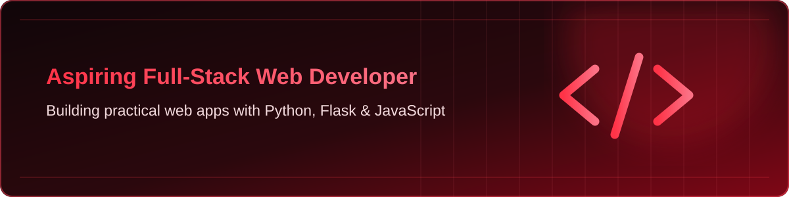
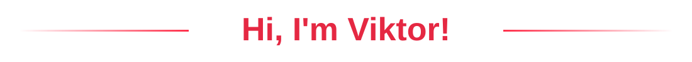

  

**Aspiring Full-Stack Web Developer**

I build practical web applications with Python, Flask, JavaScript, HTML and CSS.  
I'm improving my backend development skills and turning ideas into useful projects.

---

- 🎓 Learning full-stack web development, with a focus on **Python and Flask**.
- 💻 Building responsive frontend interfaces, backend APIs and database-driven apps.
- 🤖 Exploring AI-assisted development while improving my programming skills.
- 🎯 My goal is to grow through hands-on projects and continuous learning.

**Frontend**  
  

**Backend & Database**  
  

**Tools**  
  

### 🧹 [CleanSpace](https://github.com/ReLaX-TG/CleanSpace)

Full-stack demo for a fictional cleaning service, featuring:
- Interactive service calculator and order requests
- Admin CRM for managing incoming orders
- Flask backend and SQLite database
- Telegram notifications
- Responsive frontend

**Stack:** Python · Flask · SQLite · JavaScript · HTML · CSS  

### 💰 [Money Tracker](https://github.com/ReLaX-TG/money-tracker)

Personal finance tracker for recording income and expenses and exploring spending patterns.

**Stack:** HTML · CSS · JavaScript  

### 📁 More Projects

- [Finance Tracker](https://github.com/ReLaX-TG/Finance-Tracker)
- [Password Generator Pro](https://github.com/ReLaX-TG/password-generator-pro)
- [To-Do List](https://github.com/ReLaX-TG/todo-list)

I'm actively developing my skills through practical projects.  
[Explore my repositories and contributions](https://github.com/ReLaX-TG?tab=overview)

---

**Thanks for visiting my profile!** ❤️

